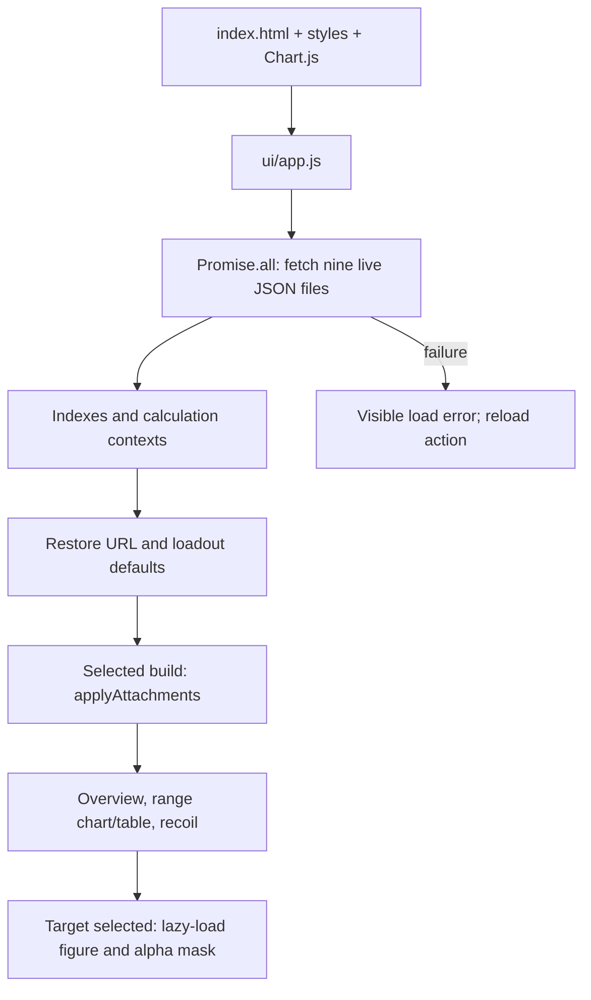

# Application architecture

[Documentation index](README.md) · [Data sources](DATA_SOURCES.md) · [User guide](USER_GUIDE.md)

## Runtime boundary and startup

The root site is a static ES-module application with [HTML markup](../index.html),
[CSS](../ui/styles.css), and a vendored [Chart.js bundle](../vendor/chart.umd.min.js)
for damage charts. It requires no package installation, bundler, application server,
or database.

The nine startup requests are `weapons.json`, `recoil_decay.json`,
`balance_tables.json`, `attachments.json`, `ammo.json`, `ballistics.json`, `hit_zones.json`, `attachment-tooltips.json`, and `weapon_attributes.json` under
`data/`. These are ordinary `fetch()` requests, not JSON module imports. A failed
request rejects initialization. Provenance, reload-exception registers, reference
workbooks, and raw Frosty exports are not browser dependencies. Required numeric
field checks report through `ui/data-errors.js`; they do not reject startup.
`sim/required-data.js` is strict by default for scripts and tests. The browser
installs a reporter and keeps missing numeric results unavailable, with a
deduplicated notification and details dialog.

[ship-surface.json](../ship-surface.json) lists the current application files and
four published historical versions for validation. It does not control access
or exclude files from deployment. Reference material may be published without
being loaded by the application.

## Module ownership

| Module | Responsibility |
|---|---|
| [ui/app.js](../ui/app.js) | Startup, application state, orchestration, charts, plot sampling/projection, events, responsive behavior. |
| [sim/loadout.js](../sim/loadout.js), [sim/attachments.js](../sim/attachments.js) | Defaults, availability, slot definitions, point totals, assumption detection. |
| [sim/applyAttachments.js](../sim/applyAttachments.js) | Base weapon → effective build; tier composition, reload, velocity, handling, ammo effects. |
| [sim/damage.js](../sim/damage.js) | Damage curves, generated per-weapon/ammo hit-zone lookup, pellet totals, BTK. |
| [sim/ballistics.js](../sim/ballistics.js) | Flight-time approximation, vector trajectory integration, zeroing. |
| [sim/core.js](../sim/core.js) | Shot intervals, recoil generation, spread growth/recovery, source-exponent radius sampling, shared display ceiling. |
| [sim/target.js](../sim/target.js) | Lazy target image, geometry/alpha hit test, zone classification, impact summaries. |
| [sim/live-fire.js](../sim/live-fire.js), [sim/sensitivity.js](../sim/sensitivity.js) | Real-time recoil/spread stepper driven by an external trigger and view rotation; mouse-count to degree conversion for the Firing Range. |
| [ui/firing-range.js](../ui/firing-range.js) | Firing Range pointer capture, animation loop and live overlay on the shared plot frame. |
| [sim/fire-modes.js](../sim/fire-modes.js) | The fire modes a weapon and its ergonomic offer, the default mode and the selected mode. |
| [sim/share-state.js](../sim/share-state.js) | Compact and legacy URL encoding/decoding and selection validation. |
| [ui/loadout.js](../ui/loadout.js), [ui/target-stats.js](../ui/target-stats.js) | Attachment controls and target-result presentation. |
| [ui/capture.js](../ui/capture.js) | Current-view PNG capture; no independent weapon calculations. |
| [ui/format.js](../ui/format.js) | Shared display formatting (milliseconds, movement multipliers) for cards and panels. |
| [ui/recoil-touch.js](../ui/recoil-touch.js) | Touch-only recoil plot controls: Redraw, Set aim, the expanded plot and its pinch/pan gestures. |

Simulation functions depend on shared tables, aim/stance, compensation, and
platform settings supplied by `setSimContext()` and the attachment context.
Callers must initialize and reset these contexts. Source records are read-only;
the attachment resolver returns a new selected build.

Projectile assembly in `ui/app.js` resolves the selected weapon/ammo to a record
in `ballistics.projectiles`, then adds the build's precise velocity. It does not
substitute global gravity/drag for missing selections. Both spray and scatter
layers call `sampleSpreadRadius()` so they use the same aim/movement exponent.

## State and rendering

`state` holds up to four loadout slots (`MAX_SLOTS`, with `slotCount` of them in a comparison), chart options, recoil options,
and collapsed panels. Loadout changes flow through the shared resolver; rendering
must not independently reapply modifiers. Overview, range charts, contextual recoil
stats, and target results consume the selected build, with different display contexts.

`WEAPON_ATTS.slots` defines physical grip/laser/light mounts independently of
category availability. `resolveMountAttachments()` validates the typed selection
and merges per-weapon fields for calculations, points, labels and assumption
markers. A shared rail accepts one device. Its consumed category keys are removed
from state; an explicit rail value, including empty, overrides stale legacy keys.

`scripts/frosty-attachment-compatibility.py` generates slots from root-listed
ability branches and `WEAPON_ATTS.dependencies` from equipment dependency IDs.
Reviewed identities connect source assets to existing site choices.
`normalizeAttachments()` removes dependent choices whose `requiresAny` list has
no selected prerequisite. Menus, points, effects and share links use these rules;
the UI refreshes the attachment section after a dependency-bearing loadout changes.

Selected builds are cached by slot, weapon reference and attachment selection.
Default builds, recoil patterns, spread sequences and trajectory calculations have
input-keyed caches. Hidden panels skip detailed rendering. Pan/zoom redraws are
scheduled on an animation frame; resize observation rebuilds plot dimensions.
Canvas backing dimensions account for device-pixel ratio. Chart.js instances are
reused rather than recreated for every ordinary update.

The target PNG and alpha mask load only when the target view is visible, including
entry through a shared link or popout. A missing image disables hit classification.
Keyboard/ARIA behavior includes labeled selects, pressed/selected controls, and a
compact-layout loadout dialog with focus trapping, Escape dismissal, inert background,
and focus restoration. On the compact layout choosing a weapon closes the dialog
(`closeLoadoutDialogAfterChoice`), so the stats show at once; the **Done** button in its
footer (`loadoutDoneBtn`), the close button and Escape close it after attachment changes,
and focus returns to the Loadout button. The wide-layout Expand pop-up is not closed by a
weapon choice. Before a weapon is chosen the attachment section shows a placeholder
instead of menus, and the empty page names the Loadout button on narrow screens
(`empty-hint-wide` and `empty-hint-narrow` in `index.html`, switched by CSS). Verify
these behaviors in a browser after UI changes.

### Sidebar, controls and touch

The sidebar's weapon slots scroll under two stacks of pinned rows, one at the top and
one at the bottom (`syncSlotStack`, `slotStackRow(i, hdr, parts)`). Each stack pins in
two stages: a weapon's header pins as soon as it scrolls under the rows above it, and the
chosen weapon's name joins it only once its own entry in the list (or the folded summary)
has also scrolled under, so the name is never on screen twice. The bottom stack mirrors
this with the chosen weapon's row first, then its header. `parts` is `'full'`, `'header'`
or `'name'`. Each hand-over is measured from the pinned row's own position, so the list row
and the pinned row coincide at the swap, and both stacks are shown while measuring and hidden
only when empty. The stacks are rebuilt on scroll, resize and sidebar render, and a pinned
row scrolls back to its weapon.

Control styling follows two classes in [styles.css](../ui/styles.css). A joined group of
choices takes `seg` (the DMG/BTK/TTK chart modes, like ADS/Hipfire), where solid gold marks
the chosen one. An independent switch (+ADS, +REC, +VEL and the Scatter, Spray, Recoil
Path, Cone and Bubbles overlays) takes `switch-btn`, which shows an outlined gold state
when on. In the charts, every chest-to-limb band uses `BAND_ALPHA` and `BAND_ORDER`, so
Chart.js draws all bands under all lines.

The touch press-and-hold tooltip lives in `initMobileTooltips()` in `ui/app.js`, not in
`ui/recoil-touch.js`, which handles the recoil plot only. On a touch device (no hover,
pointer type other than mouse) a 400 ms hold on any element with a `title` shows the
tooltip bubble without pressing the control. The click that ends the hold is swallowed, a
plain tap still works the control, and the next tap anywhere closes the bubble. Inputs,
selects, textareas and links keep their own press behaviour.

## URL compatibility contract

URL writes are debounced by 200 ms and use `history.replaceState`. The fragment is
encoded with `URLSearchParams`. The codec validates weapon IDs and attachments
against per-weapon availability; unknown/out-of-range tokens are ignored.

| Fragment field | Meaning |
|---|---|
| `w`, `a`; `cmp`, `w2`–`w4`, `a2`–`a4` | Weapon and attachment tokens for up to four weapons, and the comparison. `cmp=1` is a two-weapon comparison, as links have always written it; three or four weapons write `cmp=3` or `cmp=4`. |
| `fm`, `fm2`–`fm4` | Selected fire mode (`auto`, `burst` or `single`) of each weapon, when one has been chosen; an invalid mode falls back to the weapon's default. |
| `cm`, `hs`, `ads`, `rec`, `vel` | Chart mode, 0–4 headshots, optional ADS, sprint-recovery and flight-time additions (TTK mode only). |
| `ra`, `rs`, `rp`, `rcc`, `sh` | Aim, stance, platform, recoil-control percentage, shot count. |
| `rv`, `rd`, `rz`, `rta`, `rax`, `ray` | Target view, distance, zero, aim preset/custom coordinates. |
| `cl` | Dot-separated collapsed panel keys. |

Compact attachment tokens use **zero-based decimal catalog positions**, not IDs:
`S` sights, `M` muzzles, `B` barrels, `G` grips, `L` lasers, `T` lights, `A` ammo,
`E` ergonomics, `O` Optic Accessories, and `K` magazine keys. On a shared rail, `L` means a laser,
`R` a grip, and `H` a light. These existing tokens decode to typed `atts.rail`
state; legacy shared selections in `atts.laser`, `atts.light` and `atts.grip` are
normalized to that state. With no explicit rail selection, a legacy laser takes
priority, then a light, then a grip. This also migrates old KORD/KTS100 separate
slot links. Dependencies are checked after all tokens are read, independently of
token order. Only differences from the weapon's defaults are emitted.
Magazine positions use `Object.keys(WEAPON_MAG[id].mags)` insertion order.

Legacy dash-separated IDs use this fixed order:
`sight, muzzle, barrel, grip, laser, light, ammo, ergo, mag`.
Preserve both existing catalog order **and magazine object-key order**. UI-only menu
sorting is safe when it does not reorder the source catalogs.

New target links always carry distance (default 20 m). Old target links lacking
`rd` restore 30 m. The codec clamps decoded distance to 5–300 m and recoil control
to 0–125%; the UI subsequently snaps target distance and clamps shots to 1–100.
It validates zeroing against 100/200/300/400/500 m. See
[share-state tests](../scripts/share-state.test.mjs) for protected cases.

Seeds, layers, plot pan/zoom/magnification, spread-circle custom selections, target
stats tab, and local preferences are not encoded. Local preferences use local
storage: `bf6.targetResolutionWidth`, `bf6.targetResolutionHeight` and `bf6.targetFov`
(display); `bf6.sensDpi`, `bf6.sensValue` and `bf6.sensZoomCoefficient` (Firing Range
mouse sensitivity); `bf6.savedLoadouts` (saved loadouts); `bf6.lockedAtts1` to
`bf6.lockedAtts4` (attachment locks, one per slot); `bf6.rangeInvertY` (Firing Range
inverted vertical mouse movement); `bf6.lockHintSeen` (first-lock note shown).
Every read and write is optional ([UI and publishing](data-flow/UI_PUBLISHING.md)). The popout carries this same partial state using `?popout=1` and
operates independently after opening.

## Image capture and published history

Capture clones the rendered header and main column at its live width (plus the
loadout sidebar when the share menu asks for it), snapshots canvases, removes
interactive controls, and measures the layout in an offscreen iframe. It serializes
an SVG `foreignObject` and produces a PNG at the captured CSS width, one image pixel
per CSS pixel ([UI and publishing](data-flow/UI_PUBLISHING.md)). Overview is temporarily
expanded and restored in `finally`; other collapsed panels stay collapsed. Capture uses the existing chart bitmaps without
rerunning the simulation. Clipboard failures fall back to PNG download;
render/encoding failures produce an error state.

`v1.4.3.1/`, `v1.3.3.0/`, `v1.3.1.0/`, and `v1.2.3.0/` are self-contained historical products.
They are not imports for the current application. Keep maintenance in the live
root unless correcting a defect specific to a historical page.

## Weapon Attributes

`sim/weapon-attributes.js` creates the four-score calculator from attachment
catalogs, balance tables and `data/weapon_attributes.json`. `ui/app.js` calls
`ui/weapon-attributes.js` during Overview rendering. Each selected loadout is
resolved independently. The renderer owns compact score bars, tooltips and
related-card highlights. No screenshot audit is fetched by the browser.
See [the model guide](WEAPON_ATTRIBUTES_MODEL.md) for exceptions and unavailable results.
