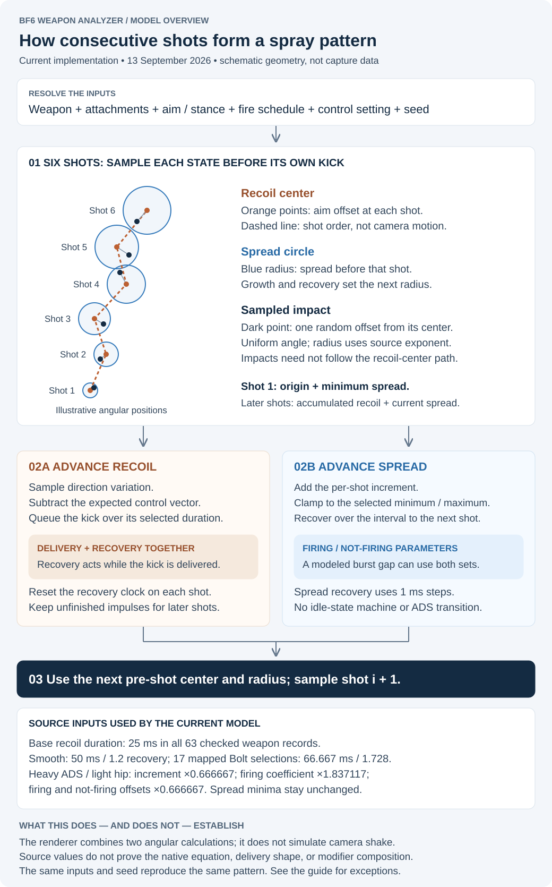
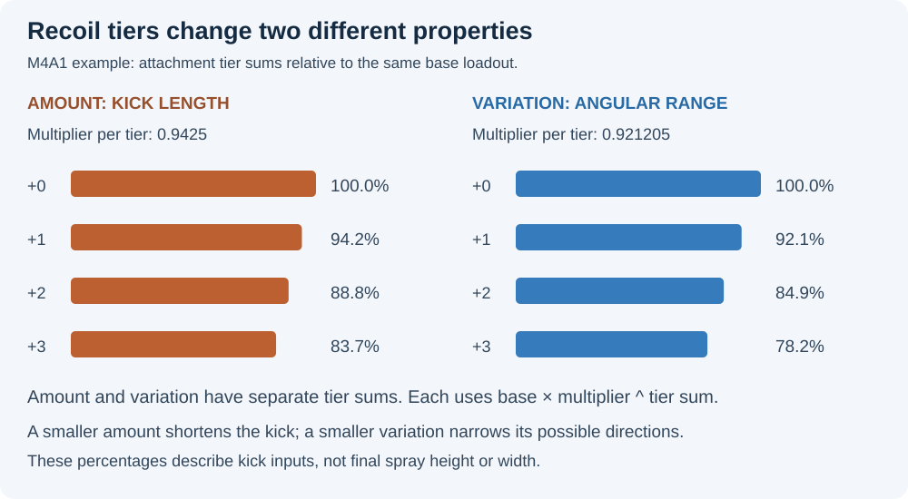
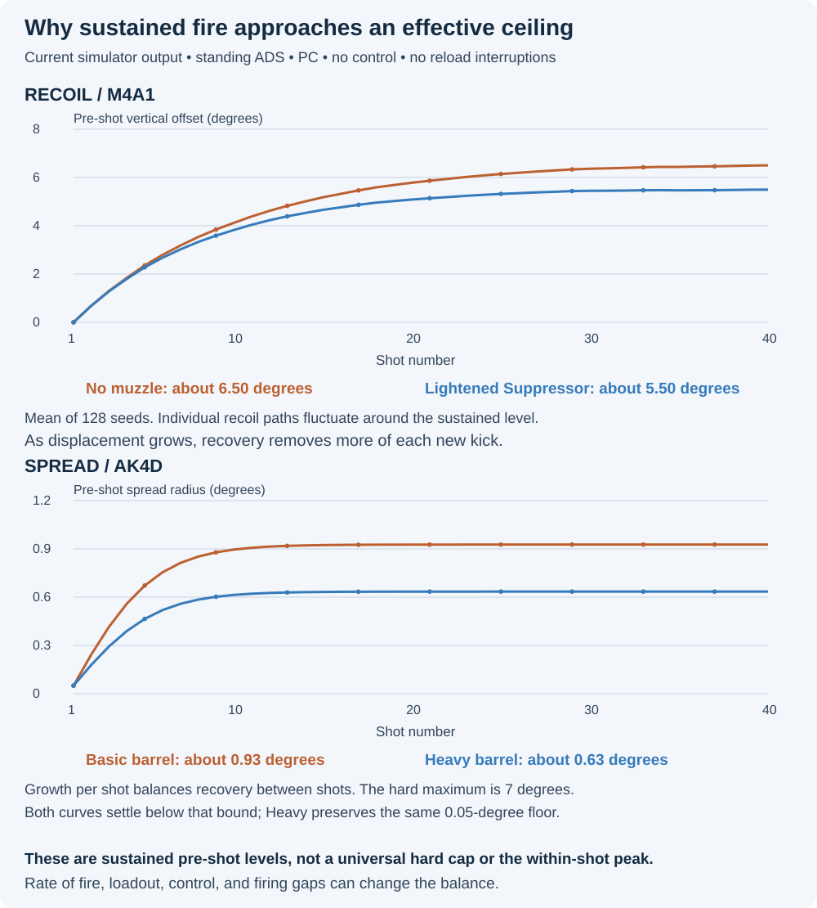
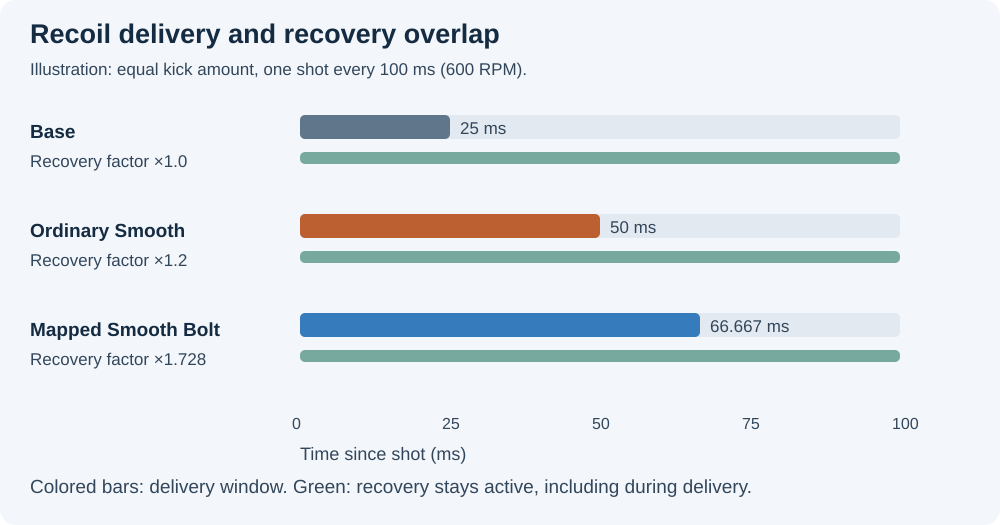
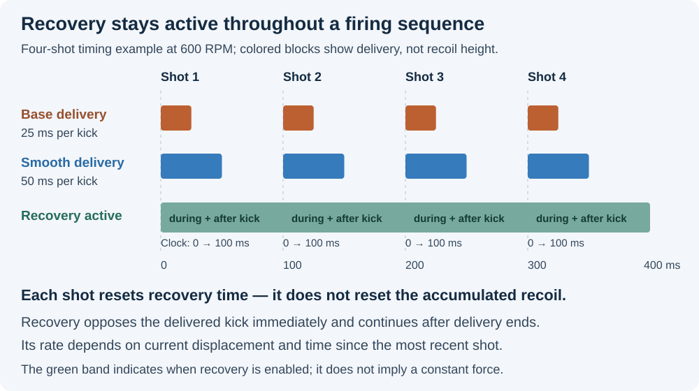
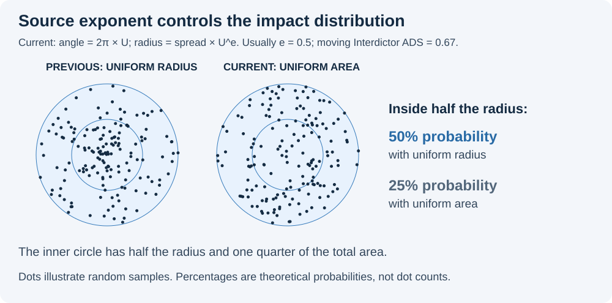

# Recoil and spread model

[Documentation index](README.md) · [Stat ladders](STAT_LADDERS.md) · [Model limitations](MODEL_LIMITATIONS.md)

The model simulates timed recoil delivery with simultaneous recovery, plus
separate spread growth and recovery.

## The Model at a Glance

The renderer combines two separate calculations at each firing instant: the
**pre-shot recoil center** and the **pre-shot spread radius**. It samples an
impact around that center, then advances both states to the next shot. Recoil
is delivered over time while recovery acts; spread has its own growth, bounds,
and recovery parameters.



`genRecoilPts()` advances recoil and `simulateSpread()` advances spread per shot.
`drawRecoilFixed()` samples impacts at render time. The RNG is seeded from the weapon ID (`whash`) so patterns are
deterministic for the same weapon, loadout, model settings and seed. Reroll changes
the reference spray; the ten scatter-cloud runs retain their fixed seeds.

## Sources and evidence boundaries

The current implementation is defined by [sim/core.js](../sim/core.js),
[sim/applyAttachments.js](../sim/applyAttachments.js), and the impact sampling in
[ui/app.js](../ui/app.js). Source inputs and policy are recorded in
[data/provenance/live-baseline.json](../data/provenance/live-baseline.json),
[data/weapons.json](../data/weapons.json), and the Frosty provenance files.

Frosty supplies the source inputs. Recovery equations, modifier composition, and
impact sampling remain model choices; see [model limitations](MODEL_LIMITATIONS.md).

Credits: Sym (weapon data and field conventions), Dr. Smiley Henry (spread
recovery reference), TheXclusiveAce (spray checks), SORROW (additional data),
and SheetOnMyFace (validation and recoil variation).

## Recoil amount and variation tiers

For a raw aim-state recoil group, the helpers calculate:

```text
amount    = group.amount * group.amountMult ^ group.amountExp
variation = group.dirVar * group.dirVarMult ^ group.dirVarExp
```

`applyAttachments()` resolves ADS amount from the weapon's effective `recoilV`
base times `RECOIL_MULT[weaponId] ^ sum(adsRecoilTierMod)`. It rounds that result
to three decimals. ADS variation uses the raw `dirVar` and
`dirVarMult ^ (dirVarExp + sum(adsRecoilVariationTierMod))`, also rounded to three
decimals. Thus a baked exponent must not be applied twice to an effective base.
Amount tiers include supported grip, muzzle, ammunition and ergonomics effects;
variation tiers include grip, muzzle and ergonomics effects.

Six sniper rifles use source +6 ADS/hip amount steps on 16 supported brake
selections. `scripts/frosty-sniper-brakes.py` generates these per-weapon muzzle
overrides from the traced XML operands, preserving existing duration/recovery
overrides. M2010 ESR with Single-Port Brake now computes 1.035 degrees ADS kick
instead of 1.410. Mini Scout Tungsten now applies -7 amount steps in both aims
from its combined -1/-6 source links; other Tungsten amount steps are unchanged. See the
[source rows](../reference-data/provenance/frosty-sniper-brakes-generated.json)
for the exact weapon/brake selections.

The ADS selection helpers scale the selected group against the effective ADS
base, so these attachment outputs reach the recoil path. Hip recoil uses its own
resolved group: the attachment resolver adds hip amount/variation tiers to that
group's exponents. Platform scaling then changes amount, not variation.



## Recoil Path (`genRecoilPts`)

The first returned point is `(0, 0)` before its own kick. To advance to each
subsequent pre-shot point:
1. Select ADS or hipfire recoil inputs based on `aimState`.
2. Compute per-shot recoil amount, including attachment tier and platform scaling.
3. Sample direction variation uniformly across the full `[-recoilVar, +recoilVar]` range.
4. Subtract the compensation vector (recoil control), scaled by the compensation %.
5. Deliver that delta uniformly over the selected recoil duration.
6. Apply recovery during and after delivery before the next shot. Each shot resets
   the recovery clock; unfinished impulses continue. The selected aim state's
   muzzle recovery multiplier scales the weapon group's decay factor.

## Spread (`simulateSpread`)

- Starts at the stance/aim spread minimum (`spreadBounds`).
- Adds `spreadInc` per shot.
- Between shots, applies recovery using `spreadRecoveries(w)` — separate firing and
  not-firing parameter sets; post-burst gaps split the interval into a firing segment
  and a not-firing segment.
- Clamps to the current state's `spread` `[min, max]` pair. Every weapon must
  define all four pairs; there is no fallback maximum.
- Shot positions use `r = spreadRadius × rng() ** distExp` with an independent
  uniform angle. The usual source exponent 0.5 gives uniform area sampling;
  moving ADS on Interdictor uses 0.67. See the evidence and limits below.

## Effective ceilings during sustained fire

Recoil recovery increases with displacement; spread recovery removes part of
each shot's increase. With a fixed loadout and firing interval, each sequence
can approach a level where per-shot input and recovery balance.



The recoil curves average 128 seeds; individual paths still vary. Spread is
deterministic for the selected state and loadout. These 40-shot sequences omit
reloads to expose the sustained balance. The plotted plateaus describe pre-shot values for these settings. They exclude
within-shot peaks and differ from the spread hard maximum. Pauses, rate of fire,
attachments, and control settings change them. The UI's `effectiveSpreadMax()` uses its
own one-magazine calculation, described below.

## Recoil recovery and shot timing

`genRecoilPts(w, seed, shots)` returns pre-shot angular offsets in degrees. The
first shot starts at `(0, 0)`. For each following point, the model adds a kick,
subtracts compensation, and recovers over the interval after the preceding shot.
With `direction = -group.dir` and a uniformly sampled angular deviation:

```text
x += sin(direction + deviation) * amount - sin(direction) * amount * control
y += cos(direction + deviation) * amount - cos(direction) * amount * control
```

Angles are converted to radians before the trigonometric functions. The delta
above is delivered uniformly over `group.duration` (normally 0.025 seconds).
Missing or zero duration uses 0.025 seconds. Recovery acts at the same time,
independently on each axis, under this assumed continuous rate equation:

```text
d(axis)/dt = deliveryRate - sign(axis) *
             (abs(axis)^decExp + decOffset) * decFactor * t^decTimeExp
```

Recovery clamps at zero. `t` restarts at each shot. During delivery, steps are at
most 1 ms and split delivery around recovery. The time-power integral is exact;
for `decExp = 1`, each recovery step also uses the exact displacement solution.
Other displacement exponents use small numerical steps. Recovery continues after
delivery with the same clock age. Overlapping impulses retain their full input.
The selected recoil group must supply explicit recovery parameters; missing
values are reported and the dependent simulation is unavailable. `_adsRecoilDecayMult` or
`_hipRecoilDecayMult` scales the factor for the selected aim state.

Smooth recoil uses the selected source duration as an override and the selected
source recovery operand as a multiplier in both aim states. The duration
override precedes the existing ergonomics duration adjustment, then clamps at
zero. Hip Smooth behavior has not been checked against hip recordings.



Recovery is continuous, not constant in strength. Each shot resets the recovery
clock while preserving the accumulated recoil and any unfinished delivery.



### The recovery law against the BF1 community formula

The closest public analog of this law is the community-measured Battlefield 1 recoil
decrease on [Sym's BF1 page](https://sym.gg/legacy/pages/bf1/bf1_generalinfo.html):

```text
RecoilTerm = ((abs(CurrentRecoil) / 0.5)^0.6 + 0.001)
Decrease   = RecoilTerm * RecoilDecrease * DeltaTime * TimeSinceLastShot^0.5 * C   (C about 5)
```

applied to each axis separately. The engine type dump in the Frosty plugin
(`FrostyPlugin/Sdk/Bf6-Strings.txt`, identical to the BF2042 dump for this structure) lists
the `GunSwayRecoilData` members that the BF1 formula uses by value. Term by term:

| BF1 term | BF6 field | BF6 value (M4A1) | Site field | Site use |
|---|---|---|---:|---|
| `abs(CurrentRecoil)` per axis | per-axis state | | `cx`, `cy` | per axis, as in BF1 |
| `/ 0.5` | `RecoilDecreaseNorm` | 1 | `decNorm` | divisor before the power; neutral at 1, so not applied |
| `^0.6` | `RecoilDecreaseExponent` | 1 (0.6 on bolt-actions and two shotguns) | `decExp` | applied |
| `+ 0.001` | `RecoilDecreaseOffset` | 0.06 (KSG reference 0.001, the BF1 value) | `decOffset` | applied |
| `RecoilDecrease` | `RecoilDecreaseFactor` | 57 | `decFactor` | applied |
| `TimeSinceLastShot^0.5` | `RecoilDecreaseTimeExponent` | 1.045 | `decTimeExp` | applied; clock reset on every shot |
| `DeltaTime` | frame step | | 1 ms steps, exact integral | continuous limit, not the engine's tick |
| `C` (about 5) | none known | | none | not applied; see the replay below |
| gated while firing in BF1 | `ShootingRecoilDecreaseScale` | 1 | `shootingDecScale` | retained; 1 means recovery runs while firing, which Sym's BF6 page states |
| none | `RecoilDuration` | 0.025 s | `duration` | timed delivery (BF2042-era field) |

The BF1 formula is a measurement, not disassembly, so this is structural support for the
form of the site's law, not proof of the BF6 arithmetic.

**Replay of alternative laws (14 October 2026).** The 10 and 11 September M4A1, TR7 and AK4D
recordings were replayed under four alternatives and a global factor scale with the camera
method of the 11 September validation and the 12 September impact-height comparison
(`outputs/recovery-variants-2026-10-14/RESULTS.md`, local). A clock running from the first
shot of a burst makes recovery 15 to 20 times too strong and is rejected. No recovery
during delivery is rejected by the Lightened Suppressor: it predicts 23% more climb than
Standard at 15 rounds where the screenshots show 14.8% less. Recovery on the vector
magnitude is indistinguishable from per-axis on these weapons (`decExp` 1). A single factor
scale does not fit all three weapons: M4A1 wants about 0.77 and TR7 and AK4D about 0.91,
and the M4A1 impact ratios keep their shape at every scale. Expressed as time, the three
weapons' shortfalls are 31, 32 and 42 ms per interval; a diagnostic dead time of 33 ms after
each shot, independent of `RecoilDuration`, brings all three long-burst peaks within 3% of
observed with one parameter. That diagnostic was fitted on the same recordings and is a
hypothesis for the next capture, not a model change. The Lightened gap (observed 14.8%
reduction, modeled 8 to 9%) and the 6 to 24% under-prediction of rapid semi-auto sequences
remain unexplained by every variant.

**AK-205 impact capture (14 October 2026).** The capture proposed from that replay was recorded
the same day: single-fire pairs at 133 and 167 ms and 5-, 10- and 15-round bursts, Standard and
Lightened Suppressor, read from bullet marks under a 5x optic whose magnification was measured at
5.00 over the 1x view in every clip. All ten measurements exceed this law run with the stored
operands: pairs 0.331 / 0.302 degrees (Standard / Lightened) at 133 ms against 0.271 / 0.244, and
0.264 / 0.225 at 167 ms against 0.190 / 0.145; bursts 1.36 / 2.13 / 2.41 degrees (Standard 5 / 10 /
15 rounds) against 1.17 / 1.74 / 1.97. A uniform factor of 0.8 on `decFactor` fits all ten (chi-square
48 against 580 as stored); the fixed dead time does not (it fits bursts only); the Standard minus
Lightened differences match the x1.2 operand. The reading rests on the 1x field of view being
103 degrees, which the operator confirmed after the capture. LMR27 pairs recorded the same evening
(L4041) give 0.384 / 0.322 degrees at 233 ms against 0.319 / 0.271 stored and 0.403 / 0.349 at
x0.8, an effective scale of 0.85 to 0.9 on the slow recovery profile (factor 13.7, exponent 0.56),
so the constant transfers across profiles within one band's error.

**Applied 14 October 2026.** The simulator multiplies every weapon's recovery factor by a single
constant, `RECOIL_RECOVERY_SCALE = 0.8` in `sim/core.js`, inside the recoil path generator. The
stored `decFactor` operands are unchanged (they remain the source values), the law's shape is
unchanged, and the Control attribute bar is not scaled because it matches the in-game stat screen.
The constant is a measured correction on an unverified law, not a decoded operand: it is pinned by
two AK-205 bands and three burst lengths and by one LMR27 band, and a second clean LMR27 band at
180 to 200 ms, or a third recovery profile, would decide whether 0.8 is exactly common.

### Duration and Smooth attachment selection

Base duration comes from `recoil.ads.duration` or `recoil.hip.duration` in the
selected weapon record. The current Frosty check covers all 63 supported weapons
and both aim states: all 126 values are **0.025 seconds**. The simulator reads the selected weapon record. A missing/zero duration
uses a fallback of **0.025 seconds**.

The four Smooth source assets define two operand sets:

| Source modifier family | Duration override | Recovery factor |
|---|---:|---:|
| `GRM_SmoothRecoil_P10`, `GRM_SmoothRecoil_Compensator_P10` | 50 ms | 1.2 |
| `GRM_SmoothRecoilBolt_P10`, `GRM_SmoothRecoilBolt_Compensator_P10` | 66.667 ms | 1.728 |

The Bolt modifiers also add -0.5 to the recovery time exponent (`decTimeExp`)
in both aim states. This uses the existing recovery equation.

The Bolt set applies only to these 19 mapped selections:

| Weapon | Muzzles using 66.667 ms and 1.728 |
|---|---|
| ELR-40 | Lightened Suppressor, Long Suppressor |
| Interdictor | Lightened Suppressor, Long Suppressor |
| L115 | Lightened Suppressor, Long Suppressor, Compensated Brake |
| M2010 ESR | Lightened Suppressor, Long Suppressor, Compensated Brake |
| Mini Scout | Lightened Suppressor, Long Suppressor, Compensated Brake, Compensator |
| PSR | Lightened Suppressor, Long Suppressor, Compensated Brake |
| SV-98 | Lightened Suppressor, Compensated Brake |

Other mapped Smooth muzzles on these rifles, including their hybrid suppressors,
use the ordinary 50 ms/1.2 set. The resolver merges the selected muzzle's
`weaponOverrides[weaponId]` into its catalog record before applying recoil effects.
It does not select values by weapon class. Ergonomic duration additions follow
the muzzle override; for example, M16A4 Smooth plus Auto receiver gives 49.4 ms.

The [duration audit](../reference-data/provenance/frosty-recoil-duration-audit-2026-09-11.json)
checks 349 source-mapped Smooth selections and retains paths, GUIDs, raw operands,
and hashes. PP-19 Flash Comp keeps the 50 ms/1.2 catalog estimate: its captured
description supports Smooth recoil, but its retained selector trace does not
resolve the modifier. The Bolt set has no separate recording validation.

Retained `decNorm` and `shootingDecScale` do not add independent recovery branches.
See the [field review and validation](archive/RECOIL_MODEL_VALIDATION_2026-09-11.md) for
all omitted recoil fields, measured agreement, and the remaining error.

`shotIntervalAfter()` uses `60 / rpm`, or `60 / burstRpm` within a burst or DB-12
pump cycle when available. After the final shot in a burst or cycle, it uses the greater of the normal
interval and `60 / burstBurstsPerMinute - (burstRounds - 1) * normalInterval`.
This distinction feeds both recoil and spread recovery.

### VSSM Folding Stock

With Folding Stock selected, both ADS and hip recoil groups use decay factor
`76` and time exponent `1.24`; without it they retain `13.7` and `0.5555`. These
source values are applied in the equation above, while the 800 RPM conversion
and existing spread/variation effects remain active. The weapon base is unchanged.

A larger decay factor alone does not establish faster recovery: raising the time
exponent reduces `t^exponent` during sub-second intervals. Smooth recoil composes
with these stock values under the rules above.

## Spread floors, growth and recovery

`simulateSpread()` records each shot's spread **before** adding that shot's
increase. The first shot therefore uses the current stance minimum. Between
shots, recovery is integrated in steps no longer than 1 ms (`SPREAD_TIME_STEP`):

```text
delta = max(spread - baseline, 0)
spread -= step * (coefficient * delta^exponent + offset)
spread = clamp(spread, baseline, maximum)
```

Ordinary shot intervals use firing recovery. A post-burst interval first uses
firing recovery for `min(60 / rpm, interval)`, then not-firing recovery for the
remaining time. Explicit not-firing fields are required; missing values are reported.
No recovery after the last recorded shot is needed for `simulateSpread()`.
Retained `idleTime`, `idleCoef`, `idleExp`, `idleOffset` and `firstShotMul`
do not introduce an idle-state machine or first-shot multiplier.
`distExp` controls impact sampling as described below.

Source structure supports this recovery form. In every supported weapon, firing
offset equals the firing coefficient times 9.72 (hip) or 2.25 (ADS, 40 weapons;
the other 22 use a linear 6.6 offset). All 24 light, barrel and bipod spread
modifiers multiply increase and all offsets by one factor k and the coefficient by
exactly k^−1.5. With exponent 2.5, that keeps `coefficient × delta^exponent + offset`
unchanged in form when spread above the minimum is scaled by k, so the equation
above, with `delta` measured from the minimum, is the one these values were built
for. The engine also defines an idle state after `IdleTime` (0.4 s ADS, 0.6 s hip)
that is not simulated. See the
[formula evidence](https://github.com/raymdl/BF6-Frosty-Research/blob/main/docs/frosty/WEAPONS.md#spread).

The stance and aim state select `adsStand`, `adsMove`, `hipStand` or `hipMove`.
Moving ADS starts with the weapon's stored `spread.adsMove[0]`. Attachment changes
shift from its index in the source-ordered seven-row `MOVING_ACC_TIERS` table,
clamped once after summing grip, laser, barrel and magazine effects. The resulting
minimum is written into `spread.adsMove[0]`; simulation and UI read that same bound.

Hip minima use all 18 source-ordered rows in `HIP_SPREAD_TABLE`. The effective
index is the weapon base (or explicit override) minus the sum of catalog hip
shifts. Both standing and moving minima come from that row; existing maximum
bounds are retained. Buckshot, 00 Buckshot and Flechette apply a source `+9`
index shift on the four shotguns. Slugs do not. Rows must not be sorted because
the shotgun shift crosses into a separate range. VSSM now uses source index 4
(1.804 degrees standing / 2.255 degrees moving), supported by the matched standing
HUD comparison. Its moving value follows the source row. See
[stat ladders and indexing](STAT_LADDERS.md).

`effectiveSpreadMax()` tracks the peak pre-shot spread across one magazine
(`N - 1` increases for `N` rounds; 50 increases when magazine size is unknown).
For nonzero spread increments the result is rounded to three decimals; a zero
increment returns the baseline directly. It includes the baseline and each
recovered next-shot value, rather than only the final endpoint. This finite
modeled peak does not establish the largest within-shot transient or the
mathematical steady state.
The shared display axis is 12 degrees.

## Heavy-type barrel source factors

Heavy, Heavy Extended and Cryogenic currently apply these changes in **ADS only**,
for both standing and moving. Hip growth and recovery retain their own inputs.

| Catalog field | Factor | Meaning |
|---|---:|---|
| `adsSpreadIncMult` | 0.666667 | Per-shot spread increase |
| `adsSpreadFiringDecCoefMult` | 1.837117 | Firing recovery coefficient |
| `adsSpreadFiringDecOffsetMult` | 0.666667 | Firing recovery offset |
| `adsSpreadNotFiringDecOffsetMult` | 0.666667 | Explicit not-firing recovery offset |

The recovery exponent and spread minima are unchanged. Missing not-firing
parameters are required, as described above. Muzzle recovery boosts
scale the ADS firing offset separately.

The resolver preserves increment precision for simulation. Scaling the flat
recovery offset along with per-shot increase matters: reducing increase alone
can keep a weapon at minimum spread throughout a firing sequence. The coefficient
then changes the balance between growth and recovery above that minimum.

The [AK4D Basic/Heavy comparison](archive/AK4D_HEAVY_BARREL_RECORDING_ANALYSIS_2026-09-11.md)
supports the ADS reduction. Other weapons and Heavy Extended/Cryogenic use the
same source factors without separate recording validation. The idle operand
remains unused because the model has no idle transition.

## Light hipfire source factors

Flashlight, Hipfire Taclight, Combo Red and Combo Green use the following source
factors in hipfire, standing or moving. The twelve source variants agree across
all 137 supported selections.

| Field | Factor | Applied behavior |
|---|---:|---|
| `hipSpreadIncMult` | 0.666667 | Per-shot hip spread increase, after ergonomic overrides |
| `hipSpreadFiringDecCoefMult` | 1.837117 | Non-linear firing recovery coefficient |
| `hipSpreadFiringDecOffsetMult` | 0.666667 | Flat firing recovery offset |
| `hipSpreadNotFiringDecOffsetMult` | 0.666667 | Explicit non-firing recovery offset |
| `hipSpreadIdleDecOffsetMult` | 0.666667 | Retained only; no idle-state transition is simulated |

The recovery exponents and light-only spread bounds stay unchanged. A combo's
laser still changes minimum spread through its existing tier. Missing non-firing
parameters are reported as unavailable. ADS is unaffected by these factors.

The resolver reads lights in ordinary or combined slots and combo effects from
the laser slot. Current Frosty slot assignments prevent selecting a separate light
alongside a combo laser; a shared-slot device contributes its light factors once.
Selection treats the light as active. Native
switching and the modifier operation order have not been decoded. See the
[source/selection trace](https://github.com/raymdl/BF6-Frosty-Research/blob/main/reference-data/provenance/frosty-light-implementation-2026-09-13.json).

This replaces the old +15% firing-offset estimate. Evaluate the lower flat recovery offset together with the reduced per-shot
spread and increased nonlinear recovery coefficient. The attachment panel shows both hip
spread per shot and the flat firing recovery value.

## Recoil control and platform

Recoil control subtracts a fraction of the expected kick vector on each shot.
It does not cancel the sampled variation or spread. The single slider defaults to
0% and allows 0–125%; values above 100% overcompensate the expected vector. There
is no separate on/off toggle. Changing platform scales amount, not variation.

The console setting applies an amount multiplier of `0.95` (2.1.1.0; `0.8836` before), taken from Frosty's
`GRM_Recoil_Controller_03`; PC uses `1`. The analyzer applies it as a final amount multiplier. Controller input, aim
assist, camera shake, and visual recoil are not simulated. Visual recoil attachment tags
do not establish corresponding changes to the generated physical shot path.

## Impact sampling and target projection

The seeded Mulberry32 generators make results repeatable for the same weapon,
loadout, settings and seed. Both shot layers use a uniform angle and source-state
radius sampling: `r = spread * rng() ** distExp`. The usual exponent 0.5 gives
uniform area. Interdictor moving ADS uses its source override of 0.67.

The [M39 EMR capture analysis](https://chatgpt.com/c/6aa60039-1c78-83e9-b381-58241012b282)
reports 22 of 88 detected marks within half the radius across four first-25-shot
takes, consistent with the 25% uniform-area prediction. This was settled hipfire
with Standard Suppressor and two seconds between shots. The reported counts cover detected marks only; they do not reconstruct every
bullet impact. Other
weapons, ADS and native field consumption remain unverified. Source values for
all 252 weapon/aim/movement combinations are recorded in
`reference-data/provenance/frosty-distribution-exponents-2026-09-13.json`.
The chart bubbles show modeled angular spread envelopes.



Angle Plot remains angular. Soldier Target projects the result at the selected
distance and uses the available projectile model for vertical displacement.
[sim/ballistics.js](../sim/ballistics.js) provides flight time and trajectory;
[sim/target.js](../sim/target.js) handles geometry and hit classification.
Projectile assembly uses available precise/base velocity and the selected
weapon/ammo projectile's generated gravity and drag. Missing selection data has
no global coefficient fallback. If trajectory resolution fails, the renderer uses
zero vertical displacement; this is a display fallback, not a measured no-drop result.
See [damage, ballistics and projection](DAMAGE_BALLISTICS.md).

Target hit and lethal-shot figures are approximate outcomes of the sampled
spray. Pellet loads suppress these figures because individual pellets are not
simulated. A circle drawn for shotgun spread is not a simulated pellet pattern.

## Verification and remaining limits

The current [attachment tests](../scripts/attachment-effects.test.mjs) cover
supported aim-state effects and ADS-only heavy barrels. The
[source-array tests](../scripts/source-arrays.test.mjs) cover exact source rows,
precision, shotgun shifts and clamping. The
[spread-scale test](../scripts/spread-bar-scale.test.mjs) checks that default and
single-attachment builds fit the display axis. These checks protect the
implementation; they do not independently validate its physical accuracy.

Unresolved areas include recoil recovery arithmetic, fitted attachment recovery
parameters, conflicting modifier activation/composition evidence, and target
sampling approximations.
