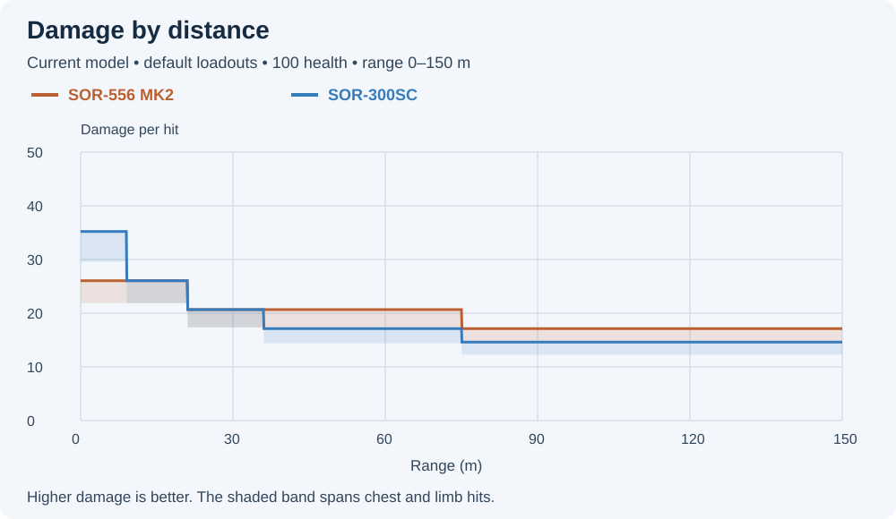
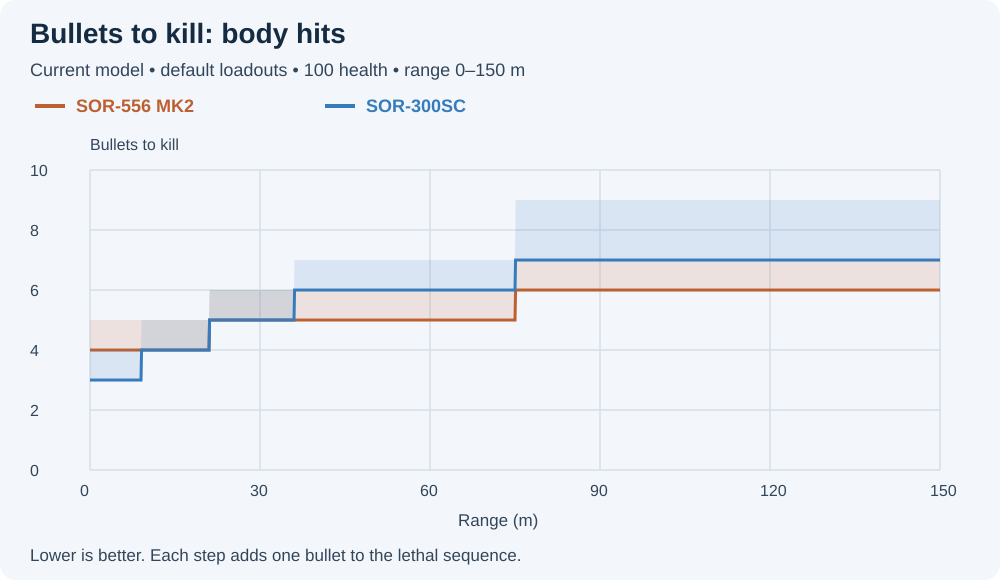
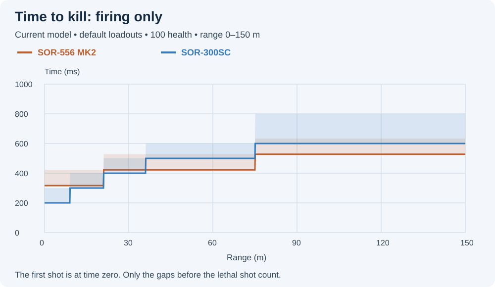
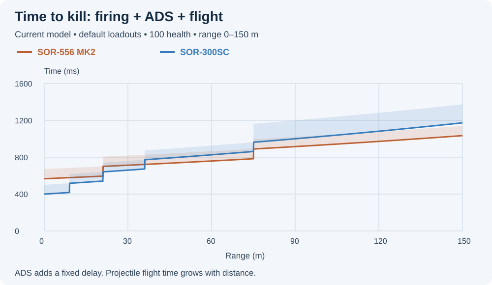
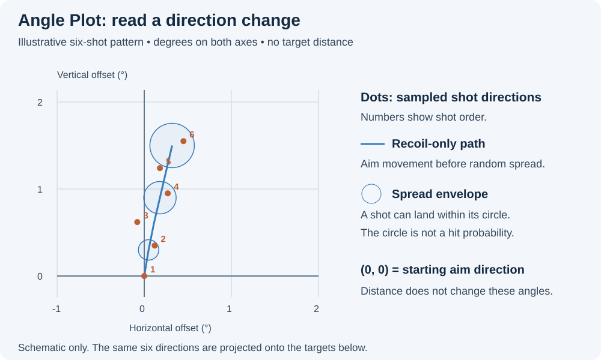
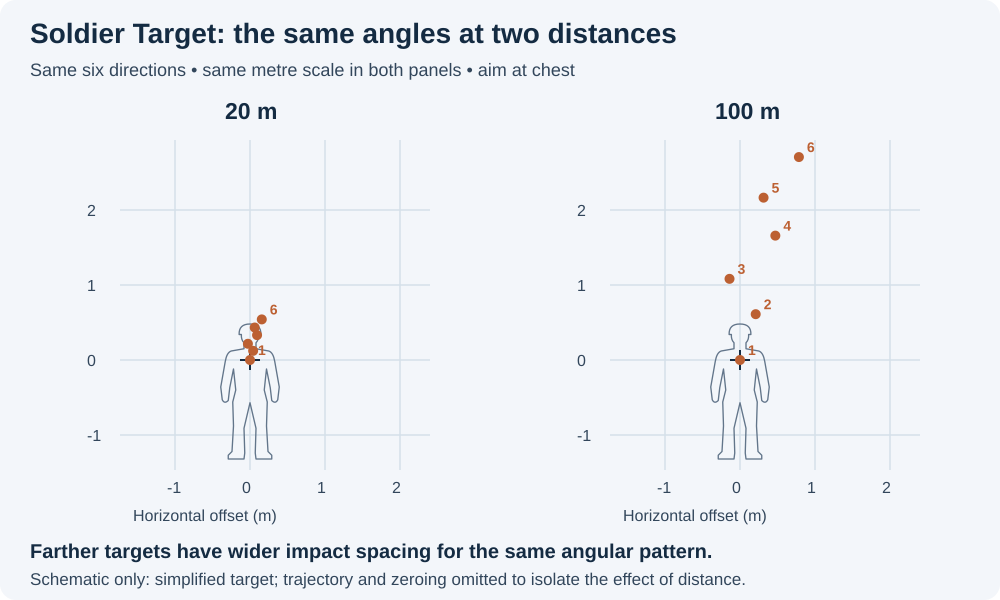

# User guide

[Documentation index](README.md) · [Model limitations](MODEL_LIMITATIONS.md)

This guide covers the current site. Published older versions retain their
original data, behavior, and controls.

## Data errors

A small notification at the panel's top right reports missing or invalid required data.
Select **View errors** to see the affected weapon and field. Close the list or
dismiss the notification to continue. A new distinct error shows the notification again.
Affected values show **—**, and calculations that need them are unavailable.
Other stats and loadouts remain usable. For example, missing RPM prevents TTK
and the time-based simulation, but does not remove damage or BTK.

## Build and compare loadouts

Select a class and weapon in the loadout panel, then select attachments, ammunition,
magazine, and ergonomics. Before any weapon is chosen, the page offers **Or try an
example: M433 vs AK4D**, which opens that comparison. Menus are filtered to the weapon's supported selections.
A shared rail has one menu labeled **Laser / Light** or **Grip / Laser / Light**.
Select one device for that rail; selecting another replaces it. Separate controls
for the same rail are hidden. Combo laser/light devices count as one attachment. A new weapon resets its build to
that weapon's recorded defaults.

Shared slots follow the Frosty records. KORD and KTS100 each have one
**Laser / Light** menu. Attachment combinations also follow dependency rules:
selecting the PP-19's 53-round magazine clears the grip and disables its menu;
selecting another magazine restores the choices. Some magazine-related ergonomics
on AK-205, RPK-74M and RPKM are restricted in the same way. Removed attachments
no longer add points or effects. Shared links also remove invalid combinations.

Attachment labels include point costs. **More than 100 points produces a warning;
it does not block calculation or sharing.** An asterisk marks an attachment with
assumed effects. A dagger (†) marks a choice whose in-game effect differs from its
description because of a game bug, or a likely one such as the RSPR Single-Port Brake's
seven recoil steps. The site shows what the game does; hovering the option says so in a
sentence, and the Attachment Effects panel marks the affected stat and adds the same
one-line footnote. Attachments with no modeled stat effect still retain their
availability and point cost.

The Attachment Effects panel also shows Recoil Duration: how long each shot's kick
takes to play out. Longer is smoother to track; the kick itself is the same size.

Hover a weapon button or a weapon name above the comparison stats to read its
in-game description. All 67 weapons have descriptions, also exposed as accessible
descriptions. Of the 63 weapons before Season 5, 61 use Frosty text and two (M2010
ESR, SV-98) use verified game captures; the four Season 5 weapons' descriptions were
read from the 2.1.1.0 files.

Hover an attachment control or option to read its in-game description where
available. The selected control also exposes the text as an accessible description.
Most text comes from Frosty UI records; 26 choices use approved game captures.
Iron Sights also has a description on each weapon. M16A4 uses its Classic sights;
UMG-40 uses its basic aperture sights. Optics are listed by their in-game names,
with their magnification, and have no description yet. Text appears without an introductory prefix and
does not define the simulated effects. Some choices still have no description.

Each attachment row has a padlock; the one in the Attachments header locks every
row with something fitted (a "None" stays free) or unlocks every row at once. A locked choice stays when another weapon is chosen.
Where the new weapon has the same attachment as its own record, that one is
fitted and counts as the locked choice: the same name with weapon-specific cost
or effects (Slim Angled on SMGs and sniper rifles, the sniper versions of the
vertical and stubby grips and bipods), or a brake of one cost under its name
by weapon: the 5-point Single-Port Brake, Slant Brake or Thread Protector, and
the 10-point Double-Port or Triple-Port Brake. Matching
cost and effects alone do not make one attachment: Rail Cover and Speed Holster,
or two optics of one zoom, stay separate. One the new weapon cannot take goes
back to that weapon's default until a
weapon that can take it is chosen again. Changing a locked attachment locks it at
the new choice. Locked rows take a gold edge; a dashed edge, with a line naming
the locked choice, means the weapon cannot take it and the row shows its default
instead. A one-time note explains this the first time a lock goes on. The locks
are remembered per slot in browser storage.

Saved Loadouts, above the class filter, live in browser storage, not in links.
Save opens a name field in the row, suggesting "Loadout 1", "Loadout 2" and so on
per weapon (Enter or Save keeps it, Escape cancels; a name already used for that
weapon is overwritten). The menu lists them grouped by weapon and loads one into
that slot, clearing its locks; each entry's ✕ deletes it at once, with an Undo link for a few seconds. A saved loadout is
stored as the same compact tokens a share link uses, so it keeps resolving as
the catalog grows.

Select **+ Add Weapon** to add Weapon 2, then Weapon 3 and Weapon 4, each an
independent loadout; the button stays greyed out at four weapons and on the Firing
Range. The sidebar is headed **Weapon 1** (gold) at the top, with **Weapon 2** (blue),
**Weapon 3** (pink) and **Weapon 4** (teal) below it, and each weapon's controls
(class buttons, selected weapon, points total, attachment menus, locks and
saved-loadout row) take its colour. Every compare weapon has a **×** that removes it;
the weapons after it move up a place. A weapon's chevron folds it to its header and
chosen weapon. Two icon buttons beside the add button work on the weapons already
chosen. **Swap** exchanges two weapons, locks included: with two weapons chosen it acts
at once, otherwise pick the source weapon and then the one to swap it with.
**Copy** puts a weapon and its attachments onto another weapon, or into the next empty
place, to compare attachment changes on the same weapon; with only Weapon 1 chosen it
adds Weapon 2. A third button, **Expand**, opens the loadout as a wide pop-up on desktop.
On smaller screens, the Loadout button opens a dialog. Choosing a
weapon closes it so the stats show; **Done**, the close button or Escape closes it
after attachment changes, returning focus to the opener. As the list scrolls, a weapon's
header pins at the top, and its chosen weapon joins the header once its own row has
scrolled under; tap the pinned rows to return to that weapon. Weapons further down pin
at the bottom the same way, chosen weapon first and its header after it.
The attachment menus appear once a weapon is chosen.

## Overview and attachment effects

The Weapon Attributes strip shows **Hipfire, Precision, Control and Mobility**
for each selected loadout. Scores update when you change attachments. Each weapon
keeps its colour: gold, blue, pink and teal for Weapons 1 to 4. Select an attribute to highlight its related stat
cards, and hover for its input explanation. These are game ratings, not percentages.
`Unavailable` means the model has no verified result for that combination.
See the [model guide](WEAPON_ATTRIBUTES_MODEL.md) for calculation and validation limits.

Overview groups combat, ammunition, mobility, recoil, spread, and concealment
statistics. The attachment-effects breakdown compares values with the bare weapon:
no barrel, the default ammunition, and the default magazine without its handling
shifts. The default barrel and magazine therefore show their own effects, such as
Basic's faster ADS time and the standard magazine's faster draw. A chip stays at
±0 when two attachments cancel each other.
Hover or tap a chip to see each attachment's own contribution with its tier step
or multiplier, and the net when more than one attachment contributes.
Multiplied factors show their × step. When tier steps of different sizes keep
the rows from adding up to the net, the breakdown says so. A stat whose contributions cancel shows
±0 in grey. Favorable indicators follow each stat's direction: higher damage/velocity,
or lower reload time/dispersion. They apply to individual stats only.

**Weapon Sway** shows the percentage change from sight, muzzle, barrel and magazine
effects relative to the bare weapon. Iron sights reduce sway on most weapons; optics
do not. Camera sway is excluded. Green **Yes** chips show capabilities such as Fire
while Sprinting, Reload in ADS or a flashlight's activation. **Hip Spread/Shot**
shows spread added by each hipfire shot. A light or Heavy-type barrel that reduces
the increase scales bloom recovery by the same factor, so bloom stays
proportionally smaller and clears no slower. The **Spread Recovery** chips leave
that scaling out and show only real changes, such as a muzzle's recovery boost.

Headshot, limb and collateral values follow the selected weapon and ammo. For a
shotgun pellet load, **Base Damage** shows the shell with every pellet hitting and
then one pellet's damage, and **Magazine Size** shows shells and pellets per shell
for the selected ammo.
Collateral is displayed as a multiplier; wall penetration is not simulated. Enemy regeneration delay is 5 s normally, 9 s with Frangible,
and 7 s with Flechette. Healing is not included in TTK.

The overview's recoil values and ADS-related fields describe the selected build's
ADS baseline. Changing the recoil plot to hipfire changes that plot's simulation
and contextual recoil statistics; it does not redefine every overview card.
Source precision is retained for calculations even where cards round milliseconds,
velocity, or movement multipliers. Missing values show as unavailable where supported; they do not represent a
measured zero.

## Damage, bullets to kill, and time to kill

| View | What it shows | Interpretation |
|---|---|---|
| Damage | Chest damage by distance, with a chest-to-limb band where multipliers differ. | The plotted damage is capped at 100; the underlying calculation and the chart read-out retain higher damage. |
| Bullets to kill (BTK) | Shots required against 100 health, with 0–4 headshots and remaining chest/limb hits. | Headshots are a count within the lethal sequence, not a hit-rate percentage. A dashed 0-headshot baseline helps compare scenarios. |
| Time to kill (TTK) | Time from the first shot to the lethal shot. Optional ADS and projectile flight time are added. | No reaction time, misses, reload interruptions, armor, or target regeneration is included. |

**DMG**, **BTK** and **TTK** form one joined group, and the lit button is the
chosen view. **+ADS**, **+REC** and **+VEL** appear with TTK and are independent
switches: each shows an outlined gold state when on, so solid gold always marks the
chosen one of a group. The headshot setting affects BTK and TTK. Chest/limb bands describe alternative
hit placement, not statistical confidence. Shotgun damage/BTK assumes all pellets
hit the selected zone. Bolt- and pump-action TTK use source manual-cycle timing;
DB-12 includes two shots per pump cycle. Burst weapons use separate within-burst
and between-burst cadence. The kill table lists results at class-specific distances.
See [damage and ballistics](DAMAGE_BALLISTICS.md) for the equations and endpoint rules.

### The kill table

The table beside the chart is titled **BTK / TTK**. Each weapon's name sits centred
over its three columns, in its colour: **DMG** (damage per shot, the full shell for a
pellet load), **BTK** and **TTK** (the TTK heading adds +ADS, +REC and +Flight when those
are on). A BTK or TTK cell shows a chest–limb range where limb hits need more
bullets, and a BTK that changes from the row above is marked. The rows are distances
chosen by the classes shown: 0 to 250 m when a sniper rifle is shown, otherwise 0 to
100 m with a DMR, 0 to 30 m for shotguns alone (to 75 m when a shotgun is compared
with another class) and 0 to 80 m in 10 m steps for the rest.

On the Soldier Target and Firing Range views, one row is outlined: the nearest row
whose DMG and BTK, for every weapon shown, match the values at the target distance
(none when no row matches); its title names that distance. The chart and the table
are linked: pointing at a range on the chart lights the matching row, and pointing
at a row moves the chart's read-out to that row's distance.

### Read the comparison charts

Each colour identifies a selected weapon: gold is Weapon 1, blue Weapon 2, pink
Weapon 3 and teal Weapon 4. Up to four can be drawn together; the illustrations
below show two.
The horizontal axis is range in metres; the vertical axis uses the selected chart
mode. The illustrations below compare SOR-556 Mk2 with SOR-300SC; they draw
Weapon 1 in orange rather than the app's gold.

The chart has one read-out box and no other tooltip. It follows the pointer, sitting
on whichever side of the pointer line and at whichever end of the plot covers the fewest
lines and bands, and shows the range over one row per weapon, in the weapon's colour, labelled with the
chart mode (DMG, BTK or TTK). Its columns are CHEST, LIMBS and HEAD in Damage (damage
is not capped there), CHEST and LIMBS in BTK, and CHEST and LIMBS plus ADS and FLIGHT,
when those additions are on, in TTK; a column appears only where it applies to a
weapon. When the pointer is off the chart on the Soldier Target and Firing Range
views, the box sits at the target distance, which a dashed line marks.

- **Solid colored line:** The result for chest hits. In BTK and TTK, any selected
  headshots are counted first; the remaining hits are chest hits.
- **Shaded band of the same color:** The range between chest-hit and limb-hit
  results. Its other edge shows the result if those body hits strike limbs.
  Limb hits deal less damage, so this edge is **below** the chest line in Damage
  and **above** it in BTK and TTK. A mix of chest and limb hits can give a result
  between these limits. Bullet counts remain whole numbers.
- **Overlapping shaded bands:** Two or more weapons can produce results in that range,
  depending on hit location. The darker or mixed color is only the two fills
  drawn over each other. It does not mean extra damage or a more likely result.
- **Overlapping lines:** Two weapons have the same value at that distance.
  One line can cover the other; this does not mean a weapon has no data.

The bands show different hit locations, not random spread, accuracy, or statistical
uncertainty. A band can disappear where chest and limb hits give the same result.

**Damage:** Higher means more damage per hit. In this example, blue starts
higher but drops sooner. The solid line is chest damage; the lower edge of each
band is limb damage.

**BTK:** Lower means fewer hits needed to remove 100 health. Steps
occur when damage falls far enough to require another bullet. The solid line
shows the chest-hit count; the upper edge shows the limb-hit count. A band from
4 to 5 means four chest hits or five limb hits are required.

Use the **headshots dropdown** to select 0–4 headshots, with any remaining hits
on the body. This is a count, not a percentage. If fewer headshots already kill,
the count stops there. When headshots are selected, dashed lines retain the
zero-headshot chest baseline.

**TTK:** Lower means less time to kill. The solid line shows chest-hit timing;
the upper edge shows limb-hit timing. Firing-only TTK starts at
the first shot and counts the gaps until the lethal shot. Four hits at 600 RPM
need three 100 ms gaps: **300 ms**, as shown in the
[TTK timing example](DAMAGE_BALLISTICS.md#firing-cadence-and-ttk).

**+ADS and +VEL:** Add the time to aim down sights and the projectile's flight
time. In the next chart both additions are enabled. The vertical axis
changes to **Time to Kill + ADS + Flight**. Travel time grows with distance, so
these lines can slope even between bullet-count steps.

**+REC:** Add the selected loadout's sprint recovery time to the TTK chart and
table. This option works alone or together with +ADS and +VEL.

## Recoil and spread

Choose **Angle Plot** for angular comparison, **Soldier Target** for a projected
pattern at distance, or **Firing Range** to fire the weapon yourself with your mouse. Choose ADS/hipfire, standing/moving, PC/console, and 1–100 shots.
These are model contexts; they do not add crouch, prone, player skill, or aim-assist simulation.

| Layer/control | Meaning |
|---|---|
| Scatter cloud | Ten fixed seeded runs showing variability around the modeled path. It is not a confidence region. |
| Spray | One sampled run, including random spread. Reroll selects another reference seed. |
| Recoil path | Aim displacement without the random spread sample. |
| Spread circles / cone | Angular spread envelopes, with selectable shot samples. They describe the model's bounds. |
| Recoil control | Subtracts 0–125% of the expected recoil vector; defaults to 0%. It leaves random variation and spread. Values above 100% overcompensate. In Firing Range the slider is disabled and your mouse takes its place. |
| Zoom, pan, crosshair | Change the plot view without altering simulated accuracy. |

Scatter, Spray, Recoil Path, Cone and Bubbles are independent switches and use the
same outlined gold state when on as the chart's +ADS, +REC and +VEL.

Spread-circle samples offer growth, early-shot, all-shot, and custom selections.
Custom examples: `1,2,5-8`, `every 3`, or `all`; `every 3` begins at shot 1.
The effective-spread statistic is the peak pre-shot spread across one magazine of
sustained fire, not the highest transient spread or a proven infinite-fire equilibrium.
The [recoil guide](RECOIL_SPREAD_MODEL.md) explains each layer and the per-shot sequence.

Recoil is delivered over the selected weapon/attachment duration while recovery
acts at the same time. Smooth attachments use source duration and recovery values;
some weapon–muzzle pairs differ from the ordinary 50 ms/1.2 set. Heavy-type barrels
use source ADS spread factors supported by the AK4D recordings. Recoil recovery runs at 0.8 of the
source factor, measured on bullet-hole captures of four weapons in October 2026, and the spread
recovery law was checked against the in-game spread indicator; the native equations themselves
are not decoded.

Flashlight, Hipfire Taclight, Combo Red and Combo Green now use source hipfire
growth/recovery factors. The model treats a selected light as active; it has no
light switch or automatic on/off simulation. Aimed Taclight has no hipfire bonus.
The console setting scales recoil amount by 0.95; it does not simulate aim assist.

Shots are sampled uniformly over the spread circle's area when the source exponent
is 0.5. This gives 25% probability inside half the radius, consistent with the M39
settled-hipfire test. Interdictor moving ADS uses its separate 0.67 exponent.
The circle still shows the maximum modeled radius, not a region containing a
fixed percentage of a whole burst.

### Touch controls on phones and tablets

On a touch screen, press and hold any button, toggle, lock or attribute bar to read
its description in a bubble without pressing it; a plain tap works the control as
usual, and the next tap anywhere closes the bubble. Stat cards and effect chips
open their breakdown on a plain tap.

Touch-capable viewports up to 1440 CSS pixels wide show **Redraw** and **Expand**.
Redraw selects a new spray sample in either view: Angle Plot keeps its origin at
(0, 0), and Soldier Target keeps the current aim. In Soldier Target, **Set aim**
arms one tap on the plot to place an aim point and redraw, then turns off. Tap
**Cancel aim** to leave the aim unchanged. A scroll or two-finger gesture does
not place an aim point.

**Expand** opens a near-full-screen plot with the same view and controls. Inside
it, pinch with two fingers to zoom around their midpoint, or move both fingers
to pan. These gestures keep the aim and spray sample. **Reset view** resets only
zoom and pan, keeping distance, aim and sample; **Close** returns to the page.
The inline plot still allows normal page scrolling. The zoom slider remains
available in both layouts, and target zoom follows its optic-magnification stops.

Keyboard users can operate these buttons, use the existing arrow/plus/minus plot
controls, and press Enter after Set aim to aim at the plot center. Escape closes
the expanded plot. The 0 key resets only the view while expanded; the inline
reset button and 0 key retain their existing full-reset behavior. Touch controls
do not change mouse/pen modifier gestures. Wider viewports keep the desktop layout.

### Angle Plot: how far the aim turns

An angle describes a direction change, not a distance on the target. Turning
1 degree to the right is the same turn whether the target is 20 or 100 metres
away. **Angle Plot** uses degrees on both axes: right/left is horizontal offset,
and up/down is vertical offset from the original aim direction. `(0, 0)` is the
starting aim point. A dot at `(1, 3)` is 1 degree right and 3 degrees up.

Use this view to compare the shape and angular size of sprays without choosing
a target distance. Zoom changes how large the plot appears; it does not change
the simulated recoil or spread.

This schematic shows six illustrative shot directions. The line connects recoil
centers; the circles show selected spread envelopes. The numbered dots include
spread. The points are illustrative and contain no measured weapon data.

### Soldier Target: where those directions land

**Soldier Target** projects the angular pattern onto a person-sized target at the
selected distance. Physical impact spacing increases with target distance for a fixed angular spread.

For example, a **1-degree horizontal offset** is about **35 cm at 20 m**, or
**1.75 m at 100 m**. The angle is unchanged. The horizontal miss distance is
`distance × tan(angle)`. Vertical placement also uses the projectile trajectory
and zeroing where available.

| Same angular offset | Target at 20 m | Target at 100 m |
|---|---:|---:|
| 1 degree horizontally | About 0.35 m from the aim line | About 1.75 m from the aim line |

Both panels project the same six directions at the same metre scale. Trajectory and zeroing
are omitted here to isolate distance. In the app, solid dots hit the target and
faded dots miss. Hit percentages describe the simulated sample, not the player's
expected accuracy.

## Soldier Target

Distance ranges from 5 to 300 metres and starts at 20 metres. The slider snaps to
coarser distance increments farther away. Magnification, display resolution/aspect,
and horizontal FOV change the viewing scale.

The zoom starts at Weapon 1's sight: 1.50× for iron sights, the stated
magnification for a fixed optic, and the high end of a variable optic's range. An
optic only zooms when aiming down it, so hipfire starts at 1.00× whatever the sight.
The zoom slider overrides it, separately for ADS and hipfire. Off the sight's own zoom, a tick on the slider marks where
that zoom is. The zoom read-out turns gold with an asterisk when the zoom
is one the sight cannot show; a variable optic's whole range counts as its own.
Reset, or choosing another sight, returns the zoom to the sight. Display resolution/FOV preferences
are saved locally when browser storage is available.

Aim at chest or head, or Ctrl+click the plot to place a custom aim point and fire a
new sample. Shift+drag pans the target view, Shift+scroll zooms and Ctrl+scroll steps
the distance. The soldier remains fixed in world
space when the aim point changes. DMR/sniper builds expose zero distances from
100 to 500 metres; other weapons use the bore-relative trajectory in this model.

Target Impact Stats is a tab beside **Recoil / Spread Stats**, greyed out on the
Angle Plot. It shows one card per weapon, in weapon order; the pop-out
stacks the stats blocks with no tabs. The cards report hits, sampled hit rate,
damage by body part, and the hits/shots needed to reach lethal damage. Total damage includes subsequent hits
after the first lethal shot. The 180 cm figure and its hit zones are approximate;
results describe this sample, not expected player accuracy. If its image is missing,
hit statistics are unavailable. For a shotgun pellet load the spray dots are the
pellets, each scattered inside the weapon's dispersion cone around its shell, and
the impact table counts pellets; the scatter cloud, bubbles and cone still show
the shell directions.

## Firing Range

**Firing Range** runs the same recoil and spread model in real time, with your own
mouse as the recoil control instead of the Recoil Control slider. It uses the
Soldier Target geometry, distance and zoom, and fires only the first weapon.
Mouse movement against the recoil cancels it, as in the game: after a string you
pulled down against, only the kick you did not counter recovers, so the view
settles back on the aim point instead of below it.

Click the plot to capture the mouse; the crosshair starts under the cursor and
the click itself does not fire. Hold the left button to fire a full-auto weapon,
click once per shot for semi-automatic, bolt and pump weapons, or click once per
burst. The magazine empties at its real size. While the plot holds the mouse the
cursor is hidden, so the keys are the controls: **R** reloads and clears the
shots, **C** clears the shots, **X** steps the fire mode (Auto, Burst, Semi), **Esc** releases the
mouse. Moving the crosshair up
past the top of the plot puts a cursor over the distance and zoom sliders and the
reset button, where a press works a button and a held press drags a slider. **Shift
+ drag** pans, **Shift + scroll** zooms and **Ctrl + scroll** steps the distance,
with or without the mouse captured; a distance change clears the shots, since hits
were scored at the old range. The **Reload** and
**Clear** buttons in the plot's bottom corner do the same, keeping distance, zoom and aim;
while the plot holds the mouse, aim the crosshair at a button and press to use it.
An invert button in the plot's bottom-right corner reverses vertical mouse movement,
and is saved in the browser like the mouse settings below. In the plot's top corner, **Semi**, **Burst** and **Auto** switch
the fire mode between the modes the weapon and its ergonomic offer (an M16A4
offers Burst and Semi, and Auto and Semi with the A3 Receiver; the KORD 6P67 and
the other Burst Training weapons offer all three bare; a weapon with one mode
shows no buttons).
The mode carries into the stats, the overview and share links, and a Match
Trigger's semi-automatic effects apply in Semi.
The reset button also returns the view and the aim to the starting point. The ring around the crosshair is the spread the next shot would
be sampled from. With a shotgun pellet load a dashed outer ring adds the weapon's
dispersion cone: the shell lands inside the inner ring and its pellets scatter
around it, inside the dashed one, as measured on the in-game wall. Each pellet
is scored at its own hit zone, so the impact table counts pellets. Dots are
coloured by hit zone (red head, gold upper torso, off-white lower torso, arms and
legs) and faded grey dots miss. When the running damage reaches a kill (100), the killing shot
flashes a red ring and a KILL line names the shot and the time from the first shot on the
board to the kill; clear or reload between attempts so the clock starts fresh. The Target Impact Stats describe the shots fired so far. Only
Weapon 1 fires, so the compare weapons are put aside while the range is up and
come back on the other views; share links still carry them. The impact table
names Weapon 1 alone.

Enter your mouse **DPI**, the in-game **Soldier Mouse Sensitivity** and the
**Uniform Infantry Aiming coefficient** (default 178%) under the plot. These
are saved locally, like the display settings, and never written to shared links.
The read-out shows the hipfire cm/360 and the degrees of view rotation per mouse
count for the current aim state and zoom. Hipfire uses the Battlefield 6 yaw
constant (sensitivity × 0.0017362342283 + 0.002314981532 degrees per count), which
reproduces the in-game settings panel's 360° mouse distances at sensitivity 15, 24
and 55 for 800, 1,600 and 3,200 DPI to the displayed decimal (24 October 2026).
The ADS scaling uses the community
monitor-distance formula for the FOV and the plot's magnification; it has not been
confirmed against BF6 source values. The browser requests raw mouse input where it
can; otherwise operating-system pointer acceleration applies. Pointer capture
needs a mouse and a desktop browser, so the view is not usable on touch devices.

## Share, capture, and pop out

**Copy Link** saves the selected weapons, attachments, and supported chart/recoil
settings in the URL fragment. It does not save the reroll seed, plot layers, zoom/pan,
custom spread-circle selection, or local display preferences. Opening the same link
reconstructs the build and encoded settings; it need not reproduce a rerolled image.
Legacy target links with no stored distance open at 30 metres for compatibility.

**Copy Image / Save Image** captures the current main view with attribution. The
capture uses the layout of the current window width at its full scroll height,
one image pixel per CSS pixel. Overview is
expanded temporarily so loadout identity is included. Other collapsed panels remain
collapsed. **Include sidebar in image** in the same menu, off by default, adds the
weapon and attachment selections on the left. Unsupported image-copy controls are disabled; a failed clipboard write
falls back to downloading the PNG. Capture failure is reported separately.

**Pop Out** opens an independent recoil window with the encoded share state.
Modify Loadout changes that window's build; subsequent changes are not synchronized.
The site logo returns to the bare root view. Panel-collapse buttons hide individual panels; share links retain their state.
