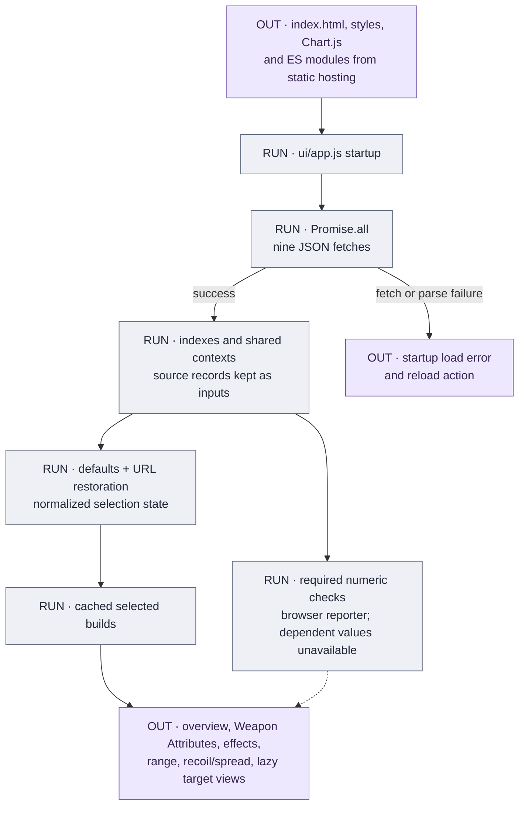
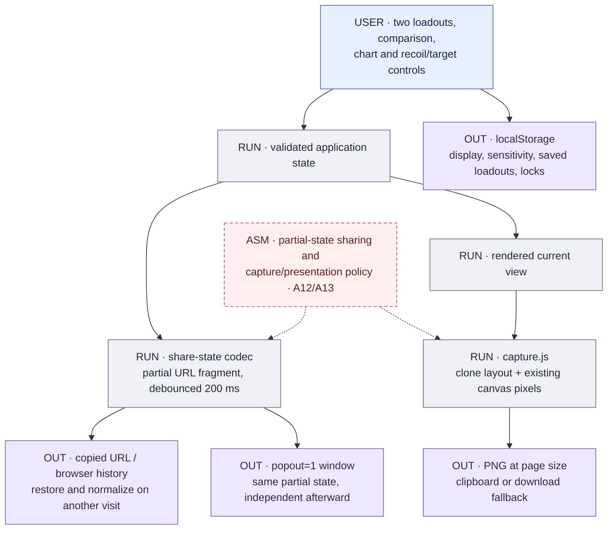
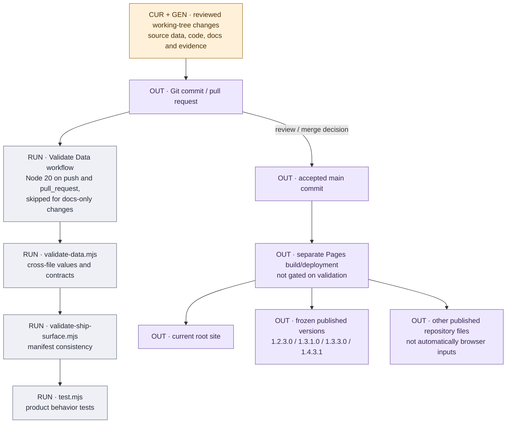

# Runtime UI, state, exports and publication

[Atlas](README.md) · [Architecture](../ARCHITECTURE.md) · [Tests](../TESTS.md)

Checked against `0ea7c0b` on 25 October 2026.

## Runtime startup

[`ui/app.js`](../../ui/app.js) fetches these files, all beneath `data/`. The list
is current on 25 October 2026; [`ship-surface.json`](../../ship-surface.json)
`runtimeData` is authoritative.

| Fetch | Runtime purpose |
|---|---|
| `weapons.json` | Roster, descriptions and base inputs. |
| `attachments.json` | Catalogs, availability/defaults, compatibility, modifiers and magazines. |
| `ammo.json` | Ammo choices, effects, velocity treatments and curve/pellet overrides. |
| `balance_tables.json` | Finite tables, factors, base maps and collateral map. |
| `ballistics.json` | Explicit weapon/ammo projectile selection and gravity/drag. |
| `hit_zones.json` | Explicit base/ammo head and limb multipliers. |
| `attachment-tooltips.json` | Text dictionary and selection-to-description lookup. |
| `recoil_decay.json` | Legacy maps retained in startup/context; current per-aim recoil groups supply active recovery inputs. |
| `weapon_attributes.json` | Precision lookup tables, shotgun dispersion and Mobility inputs for the [Weapon Attributes](LOADOUTS.md#weapon-attributes) model. |

Every request must load and parse for startup to complete, including the legacy
map file. Required numeric validation is a separate mechanism:
[`sim/required-data.js`](../../sim/required-data.js) throws by default in scripts,
while the browser installs [`ui/data-errors.js`](../../ui/data-errors.js) to report
deduplicated errors and keep affected numeric results unavailable.

Contexts inject shared tables and current aim/stance/platform/control behavior.
A reusable simulation call must initialize/reset those contexts deliberately.
Selected builds, default builds, patterns, spread sequences and trajectories use
input-sensitive caches. Hidden panels skip detailed rendering; pan/zoom redraws
are scheduled with animation frames, and canvas backing dimensions account for
device-pixel ratio.

The page identifies the two weapons by colour only: gold for Weapon 1, blue for
Weapon 2. What the main controls show:

| Element | Behavior |
|---|---|
| Sidebar | A gold "Weapon 1" heading over the first loadout and a blue "Weapon 2" heading over the compare block. Swap and Clone are icon buttons beside "+ Compare Loadout", greyed out unless comparing (Swap also needs both weapons). Weapon 2's class buttons, selected weapon, points total, attachment menus, locks, saved-loadout controls and fire-mode badge are blue. |
| Empty state | With no weapon chosen, an "Or try an example: M433 vs AK4D" button loads that comparison. |
| Range chart | Chart.js tooltips are off. One read-out box gives the range and one row per weapon in its colour, labelled with the chart mode (DMG, BTK or TTK): CHEST/LIMBS/HEAD columns in DMG mode, CHEST/LIMBS in BTK, and CHEST/LIMBS plus ADS and FLIGHT columns in TTK when they apply. It follows the pointer; otherwise, on the Soldier Target and Firing Range views, it sits at the target distance, which a dashed line marks. |
| Kill table | Titled "BTK / TTK". Each weapon's name sits centred over its DMG, BTK and TTK columns with a 1px rule in its colour. Rows are the class-specific distances from `btkRanges()`. On the target views the outlined row is the nearest row whose DMG and BTK match the values at the target distance exactly (none when no row matches). Hovering a chart range lights the matching row; hovering a row moves the chart's read-out box. |
| Attachment Effects chips | When two or more attachments contribute to one chip, a source line under the value gives each one's share. |
| Target Impact Stats | A tab beside "Recoil / Spread Stats": one card per weapon, stacked. |

## State and exports

The codec is [`sim/share-state.js`](../../sim/share-state.js). It uses
`URLSearchParams` in the fragment and `history.replaceState`, validates IDs and
availability, and normalizes shared mounts and dependencies. The link does not
write a build into a server-side database.

| State family | What persists |
|---|---|
| Loadout and comparison | Weapon 1 / Weapon 2 IDs, attachment tokens and selected fire modes (`fm`, `fm2`), comparison enabled. |
| Chart | Damage/BTK/TTK mode, selected headshot count, ADS/travel toggles. |
| Recoil | Aim, standing/moving/mounted, platform, control percentage and shot count. |
| Target | Soldier Target or Firing Range view, distance, zeroing and aim preset/custom coordinates. |
| Layout | Collapsed panel keys. |
| **Not encoded in the ordinary URL** | Seeds, visible layers, pan/zoom/magnification, custom spread-circle selections, target stats tab, display resolution and FOV, mouse sensitivity, saved loadouts and attachment locks. |
| Local preferences | Local storage keys: `bf6.targetResolutionWidth`, `bf6.targetResolutionHeight`, `bf6.targetFov` (display); `bf6.sensDpi`, `bf6.sensValue`, `bf6.sensZoomCoefficient` (Firing Range mouse sensitivity); `bf6.savedLoadouts` (named saved loadouts); `bf6.lockedAtts1`, `bf6.lockedAtts2` (per-weapon attachment locks); `bf6.lockHintSeen` (first-lock hint shown). Every read and write is optional; none travels with a shared link. |

Compact attachment tokens are a slot letter (`S`, `M`, `B`, `G`, `R`/`L`/`H` for
the shared rail, `T`, `A`, `E`, `O` for the Optic Accessory, `K` for the
magazine) followed by a **zero-based decimal catalog position**. Magazine
tokens use `Object.keys(mags)` insertion order. A legacy sight category restores
as the weapon's lowest-magnification optic of that category. Reordering catalog entries or
magazine keys changes old link meaning even when IDs and numerical values stay
unchanged. UI-only sorting can remain independent. Legacy dash-separated IDs still
restore, and legacy shared slots migrate to typed rails. New target links include
distance; old target links without it restore 30 m while the new-view default is
20 m. See the [codec contract](../ARCHITECTURE.md#url-compatibility-contract) and
[share-state tests](../../scripts/share-state.test.mjs).

PNG capture is a different export path. [`ui/capture.js`](../../ui/capture.js)
clones the header (the site address replaces the archive links) and the main
column at its live width, plus the loadout sidebar at its 228 px desktop width
when the share menu asks for it. It snapshots current canvas bitmaps, writes back
input and select values, removes interactive controls, measures the layout in an
offscreen iframe, and serializes through SVG `foreignObject` to a PNG at the
captured CSS width. The capture body drops the live page's 1700 px width cap, so a
wide window is no longer clipped or offset. Overview is temporarily expanded and
restored in `finally`; other collapsed sections stay collapsed. Existing charts are
captured rather than independently resimulated at capture size. Clipboard failure
falls back to download; rendering failure has its own error state. A PNG preserves
visible pixels, not the complete editable model state.

## Publication and validation

The checked-in [Validate Data workflow](../../.github/workflows/validate-data.yml)
runs the three commands shown. It does not run when a change touches only `docs/`,
Markdown files or `scripts/*.py`. Pages build/deployment is a separate GitHub
workflow; the repository does not make it wait for validation (A15).

[`ship-surface.json`](../../ship-surface.json) declares runtime paths, the exact
runtime JSON dependencies and the four published historical roots
(`publishedArchives`: v1.2.3.0, v1.3.1.0, v1.3.3.0, v1.4.3.1). Its validator
checks the declared surface. The manifest does not itself exclude reference files
from deployment or make them private. The audited Pages artifact includes research
and documentation files that the browser never fetches. Do not store secrets or
assume material is private merely because it is outside `runtimeData`.

The root application has no application bundler or data-ingestion job at startup.
GitHub Pages can still perform a hosting/Markdown build: that is separate from
compiling the weapon model or regenerating source data. Each historical version
is a self-contained published snapshot; the current root does not import those
versions as fallback data.

## Presentation and research boundaries

The header's displayed version (Season 5, v2.1.1.0) and the Site Versions menu
are maintained in the page. They identify the represented product/source context, not independent
measurement of every field on that build. Static artwork, favicon and social
preview assets are maintained presentation inputs.

`data/provenance/live-baseline.json`, `data/reload-exceptions.json` and
`data/weapon-role-tags.json` are maintenance/reference records despite residing
under `data/`. Reference workbooks, provenance reports and docs likewise are not
runtime dependencies. Archived plans describe historical work; ongoing research
remains under `docs/working/`. Local raw XML, SDK materials and ignored captures
are additional regeneration requirements, not hidden browser services.

## Verification responsibilities

Product tests establish consistency with the implemented model and expected
fixtures. Source generators' `--check` modes establish narrower relationships to
provided exports and mappings. Matched game recordings provide empirical checks
for their tested configurations. These are three distinct kinds of validation.
UI/layout changes additionally need browser checks for charts, target loading,
responsive controls, accessibility, captures and popouts; headless arithmetic
checks do not establish their visual correctness.
