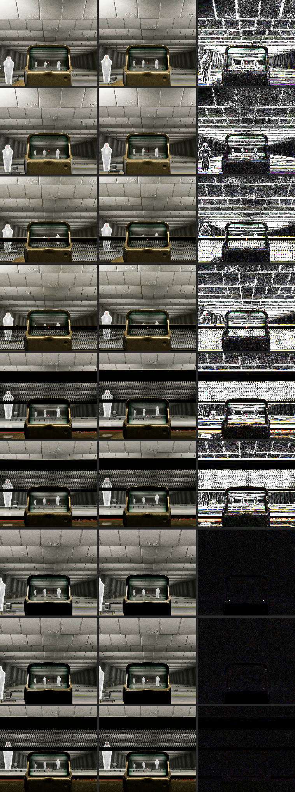

# Stance and mounted sway measurement, 26 October 2026 (client 2.1.1.0)

Operator recordings `reference-data/Recordings/10262026/Stance Sway/M433_MiniFlex_<grip>_<stance>.mp4`
(firing range, ADS, not firing, 2560x1440 at 60 fps, about 11 s each). M433 with the Mini Flex
sight; grip `None` (no bottom-rail attachment) or `Bipod`. Stances: Standing, Crouched, Prone,
CrouchMounted (rested on the range counter; the operator moved forward to reach it) and
ProneMounted (bipod only: the game does not offer a prone mount without one). In each stance
the None and Bipod clips were taken from the same position. The videos are kept locally only;
the evidence stills and per-frame tracks sit beside them, and the sheet below is in the repo.

Script: `scripts/stance-sway-track.py`. The first 2 s of each clip are skipped (possible
artifacting); about 9 s are measured. Units are pixels of the 2560x1440 frame; the ADS
camera scale is not calibrated.

## Results

Aim sway is the red dot's movement against the scene (dot screen position minus scene
shift). Cells: total horizontal × vertical range in px (RMS radius about the clip's mean).

| Stance | None | Bipod |
|---|---|---|
| Standing | 7.7 × 11.3 (3.7) | 7.9 × 11.6 (4.0) |
| Crouched | 8.4 × 11.3 (3.8) | 6.6 × 10.2 (3.6) |
| Prone | 7.7 × 11.5 (4.2) | 6.4 × 12.3 (3.8) |
| CrouchMounted | 0 × 0 (0) | 0 × 0 (0) |
| ProneMounted | not available | 0 × 0 (0) |

- Unmounted: the scene (camera) moves about 5 × 7 px, the red dot moves a further
  2.5–3.5 × 4–5 px on screen, and the weapon model stays fixed on screen (under 0.2 px).
- Vertical sway repeats about every 3 s (three cycles per clip), so the vertical range is
  complete. The horizontal drift is slower than the clip (one or two zero crossings), so the
  horizontal ranges are partial swings and only show the stances are similar.
- Mounted, with or without the bipod: scene, weapon and dot do not move. Phase-correlation
  peaks are 0.96–0.97 against 0.40–0.44 in the unmounted clips.
- The red dot was found in 50 of 592 ProneMounted frames and 373 of 535 None_Crouched
  frames; the mounted result does not depend on it.

## Conclusions

- Standing, crouched and prone sway the same on this weapon and sight.
- A fitted but undeployed bipod changes nothing.
- Mounting removes all weapon and camera sway, with or without a bipod or grip pod. The
  bipod's only part in it is allowing a prone mount.

Not covered: other weapons and magnified optics (the engine type list has a stance-and-zoom
sway setting, `GunSwayStanceZoomModifierData`), and the sway penalty for changing stance
while aiming (`GunSwayStanceChangePenalty`).

## Evidence

Rows, top to bottom: None/Bipod Standing, None/Bipod Crouched, None/Bipod Prone,
None/Bipod CrouchMounted, Bipod ProneMounted. Columns: the frame with the aim point lowest,
the frame with it highest (the first and last measured frames for the mounted clips), and
their pixel difference ×8. Moving clips light up along every edge; mounted clips stay black.
Crop: x 1030–1530, y 400–840 of the full frame, shown at half size. The full-size stills
(`*_frames<a>-<b>.png`) and per-frame tracks (`*_track.csv`) are in the recordings folder.

## Site

The Weapon Sway chip in Attachment Effects shows −100% in the Mounted stance: a Mounted
row (×0) is added after the attachment rows, so the net is −100% whatever the attachments
add (`ui/app.js`, `renderAttachmentStats`).
